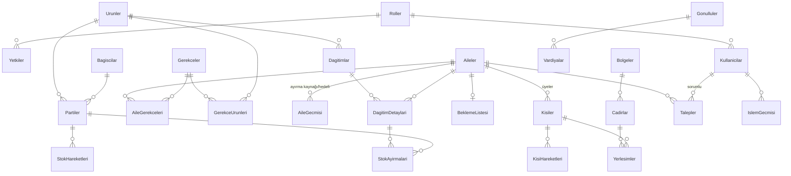

# Mimari

## 1. Katmanlar

```
AfetCadirKent.slnx
├── src/
│   ├── AfetCadirKent.Entities     Entity sınıfları, enum'lar, ortak arayüzler (bağımlılığı yok)
│   ├── AfetCadirKent.DataAccess   AfetDbContext, Fluent konfigürasyonlar, migration'lar, seed, IRepository<T>
│   ├── AfetCadirKent.Business     Servisler, kurallar, gerekçe kuralları, yapay zeka servisi, yetki, istisnalar
│   └── AfetCadirKent.UI           DevExpress WinForms formları (iş kuralı yok)
├── tests/
│   └── AfetCadirKent.Tests        xUnit (Business birim + DataAccess/servis entegrasyon)
└── docs/
```

Bağımlılık yönü: **UI → Business → DataAccess → Entities**. UI, DbContext'e erişmez; yalnızca Business servis arayüzlerini (DI ile) çağırır. Tests projesi Business ve DataAccess'e referans verir.

| Katman | Sorumluluk | Örnek |
|---|---|---|
| Entities | Veri ve kapsüllenmiş doğrulama | `Aile`, `Afetzede`, `Cadir`, `Parti`, `StokHareketi` |
| DataAccess | Kalıcılık, eşleme, seed | `AfetDbContext`, `CadirConfiguration`, `Repository<T>` |
| Business | İş kuralları, yetki, işlem geçmişi, yapay zeka | `KayitServisi`, `CadirOneriMotoru`, `OllamaYapayZekaServisi` |
| UI | Gösterim, girdi alma, mesaj | `AnaForm`, `AileKayitForm`, `CadirPlaniForm` |

## 2. Veri modeli (27 tablo)

| Grup | Tablolar |
|---|---|
| Kullanıcı ve yetki | `Kullanicilar` (Gorevli), `Roller`, `Yetkiler` |
| Kayıt | `Aileler`, `Kisiler` (Afetzede), `KisiHareketleri`, `AileGecmisi` |
| Gerekçe | `Gerekceler`, `GerekceUrunleri`, `AileGerekceleri` |
| Çadır | `Bolgeler`, `Cadirlar`, `Yerlesimler`, `BeklemeListesi` |
| Depo | `Urunler`, `Partiler`, `StokHareketleri`, `StokAyirmalari`, `Bagiscilar` |
| Dağıtım | `Dagitimlar`, `DagitimDetaylari` |
| Talep / yakın bulma | `Talepler`, `YakinBulmaBasvurulari` |
| Gönüllü | `Gonulluler`, `Vardiyalar` |
| Diğer | `Duyurular`, `IslemGecmisi` |

### Temel ilişkiler (ER özeti)



Ayrıntılı alan listesi, tipler, indeksler Aşama 2'de bu bölüme eklenecek ve ER görseli rapor için üretilecektir.

### Tasarım ilkeleri
- PK: `int Id` (identity). Numara alanları (`AileNo`, `KisiNo`) unique indeks.
- `TcKimlikNo` için filtreli unique indeks.
- Cascade delete varsayılan olarak kapalı (`Restrict`); yalnızca saf bağlı tablolarda açık.
- `RowVersion`: Cadirlar, Partiler, Aileler, Talepler, DagitimDetaylari.
- Enum'lar `int` olarak saklanır, ekranda Türkçe görünen adlarıyla gösterilir.
- Tablo/kolon adları Türkçe karaktersiz.

## 3. OOP kavramlarının yeri

| Kavram | Nerede |
|---|---|
| Soyut sınıf + kalıtım | `Kisi` (abstract) → `Afetzede`, `Gorevli`, `Gonullu`; `StokHareketi` (abstract) → `GirisHareketi`, `DagitimHareketi`, `IadeHareketi`, `HasarHareketi`, `SayimFarkiHareketi` |
| Polimorfizm | `StokHareketi.StokEtkisi` her alt sınıfta farklı; `IGerekceKurali` uygulamaları (`BebekKurali`, `HamileKurali` …) tek döngüde değerlendirilir; `IYapayZekaServisi` |
| Interface | `IGerekceKurali`, `IYapayZekaServisi`, `IRepository<T>`, `IPasifYapilabilir`, `IDenetlenebilir`, servis arayüzleri |
| Kapsülleme | Entity property'lerinde doğrulama (ör. `Cadir.Kapasite > 0`, `Kisi.Ad` boş olamaz), `private set` ile korunan alanlar, `Parti.Ayir()/Teslim()` metotları |
| Generic | `IRepository<T> where T : class`, `Repository<T>`, `SonucListesi<T>` |
| Koleksiyonlar | `List<IGerekceKurali>`, `Dictionary<UrunKategorisi, bool>` (malzeme ihtiyaçları), `Dictionary<Modul, IzinSeti>` (yetki önbelleği) |
| İstisna yönetimi | `IsKuraliException` (taban) → `DogrulamaException`, `YetkisizIslemException`, `SilinemezException`, `EszamanlilikException`; UI'da merkezi hata yakalama + Serilog |

## 4. Business servis sözleşmeleri (taslak)

| Servis | Başlıca işlemler |
|---|---|
| `IKurulumServisi` | `IlkKurulumGerekliMi()`, `IlkYoneticiOlustur(...)` |
| `IOturumServisi` | `GirisYap(kullaniciAdi, parola)`, `Cikis()`, `AktifKullanici`, `IzinVarMi(Modul, Izin)` |
| `IKullaniciServisi` | Kullanıcı CRUD, rol atama, parola değiştirme |
| `IKayitServisi` | `AileOlustur`, `KisiEkle`, `MukerrerKontrol`, `DurumDegistir`, `AiledenAyir`, `AileFisiBilgisi` |
| `IGerekceServisi` | `Degerlendir(aileId)` → `AileOncelikSonucu` (destek önceliği + gerekçeler + malzeme ihtiyaçları), `ElleEkle/ElleKaldir(aciklama)` |
| `ICadirServisi` | Bölge/çadır CRUD, `OneriGetir(aileId)`, `Yerlestir(onay)`, `CadirPlani()` |
| `IBeklemeListesiServisi` | `Ekle`, `CadirIcinOneri(cadirId)`, `OnaylaVeYerlestir` |
| `IStokServisi` | Ürün CRUD, `StokGirisi`, `Hareket(iade/hasar/sayım)`, `StokDurumu`, `SktGecenleriFireyeDus` |
| `IDagitimServisi` | `ListeOlustur(urunId)`, `ListeyiOnayla` (ayırma), `TeslimEt(miktar)`, `TeslimIptal`, `GunSonuKapat` |
| `IStokTahminServisi` | `Tahmin(urunId)` → yeterlilik, kişi başı tahmin, dönem, uyarılar |
| `ITalepServisi` | `Olustur`, `Siniflandir` (YZ), `Ata`, `DurumDegistir(sonuc)`, `Listele` (rol filtreli) |
| `IYakinBulmaServisi` | `Ara`, başvuru CRUD, durum geçişleri |
| `IGonulluServisi` | Gönüllü CRUD, vardiya, görev ataması |
| `IDuyuruServisi` | CRUD, `AktifDuyurular(tarih)` |
| `IKioskServisi` | `Giris(aileNo, dogumYili)`, `TalepBirak`, `Taleplerim`, `Duyurular` |
| `IAnaEkranServisi` | Özet göstergeler |
| `IRaporServisi` | Rapor veri kaynakları (dağıtım tutanağı, stok, nüfus, talep) |
| `IYedekServisi` | `YedekAl(yol)`, `GeriYukle(yol)` |
| `IIslemGecmisiServisi` | `Kaydet`, `Listele(filtre)` |

Her değiştirici işlem: yetki kontrolü → doğrulama → işlem (transaction) → işlem geçmişi kaydı. Kurallar saf sınıflarda (`TurkceMetin`, `TcKimlikDogrulayici`, `CadirOneriMotoru`, `FefoPartiSecici`, `HakHesaplayici`, `StokTahminci`, `TalepDurumMakinesi`) tutulur ve veritabanısız test edilir.

## 5. Yapay zeka (Ollama) entegrasyonu

```
IYapayZekaServisi
 ├─ Task<TalepSiniflandirmaSonucu> TalepSiniflandirAsync(string aciklama, CancellationToken)
 └─ Task<OzetSonucu> GunlukOzetAsync(GunlukDurumVerisi veri, CancellationToken)

OllamaYapayZekaServisi : IYapayZekaServisi   (HttpClient, OllamaAyarlari)
```

- Uç nokta: `POST {Ollama:Adres}/api/generate`, gövde: `model`, `prompt`, `system`, `format: "json"` (sınıflandırmada), `stream: false`.
- Sınıflandırma beklenen JSON: `{"tur": "Saglik|Malzeme|CadirAriza|Diger", "yardimOnceligi": "Yuksek|Orta|Normal", "gerekce": "..."}`.
- `TalepSiniflandirmaSonucu.Durum`: `Siniflandirildi` veya `Siniflandirilmamis` (+ neden). Bağlantı hatası, zaman aşımı (`Ollama:ZamanAsimiSaniye`), geçersiz JSON, bilinmeyen tür → `Siniflandirilmamis`; istisna dışarı sızmaz, loglanır.
- `TalepServisi` sonucu uygular: tür Sağlık ise öncelik atılır, `SaglikPersoneliDegerlendirecek = true`, hedef rol Sağlık personeli. Görevli öneriyi onaylar veya değiştirir.
- Günlük özet: Business, ana ekran verilerini (sayılar) toplar; yalnızca toplu sayılar ve talep başlıkları modele gönderilir; model düz metin özet döner. Veri bilgisayar dışına çıkmaz.
- Yeni bir sağlayıcı eklemek için `IYapayZekaServisi`'ni uygulayan tek sınıf yazılır ve DI kaydı değiştirilir.

## 6. UI ilkeleri

- Sadece DevExpress kontrolleri; `XtraForm` tabanı, `LayoutControl` yerleşimi, `RibbonForm` ana ekran.
- Formlar servis arayüzlerini constructor ile alır (DI).
- Uzun işlemler `async/await` + `SplashScreenManager` bekleme formu.
- Hata: `XtraMessageBox` ile sade mesaj; ayrıntı Serilog ile `logs/`.
- Yetki: Ribbon öğeleri ve butonlar izne göre gizlenir; Business yine kontrol eder.
