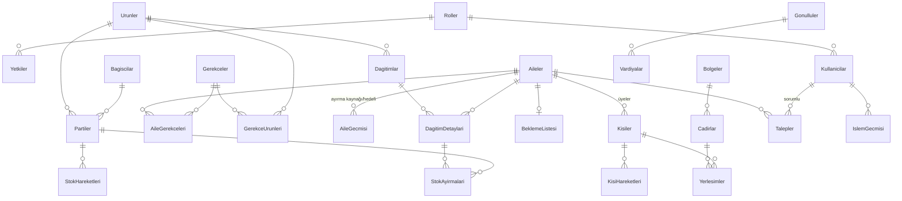

# Mimari

## 1. Katmanlar

```
AfetCadirKent.slnx
├── src/
│   ├── AfetCadirKent.Entities     Entity sınıfları, enum'lar, ortak arayüzler (bağımlılığı yok)
│   ├── AfetCadirKent.DataAccess   AfetDbContext, Fluent konfigürasyonlar, migration'lar, seed, IRepository<T>
│   ├── AfetCadirKent.Business     Servisler, kurallar, gerekçe kuralları, yapay zeka servisi, yetki, istisnalar
│   └── AfetCadirKent.UI           DevExpress WinForms formları (iş kuralı yok)
├── tests/
│   └── AfetCadirKent.Tests        xUnit (Business birim + DataAccess/servis entegrasyon)
└── docs/
```

Bağımlılık yönü: **UI → Business → DataAccess → Entities**. UI, DbContext'e erişmez; yalnızca Business servis arayüzlerini (DI ile) çağırır. Tests projesi Business ve DataAccess'e referans verir.

| Katman | Sorumluluk | Örnek |
|---|---|---|
| Entities | Veri ve kapsüllenmiş doğrulama | `Aile`, `Afetzede`, `Cadir`, `Parti`, `StokHareketi` |
| DataAccess | Kalıcılık, eşleme, seed | `AfetDbContext`, `CadirConfiguration`, `Repository<T>` |
| Business | İş kuralları, yetki, işlem geçmişi, yapay zeka | `KayitServisi`, `CadirOneriMotoru`, `FefoSecici`, `DagitimServisi`, `OllamaYapayZekaServisi` |
| UI | Gösterim, girdi alma, mesaj | `AnaForm`, `AileKayitForm`, `CadirPlaniForm` |

## 2. Veri modeli (27 tablo)

| Grup | Tablolar |
|---|---|
| Kullanıcı ve yetki | `Kullanicilar` (Gorevli), `Roller`, `Yetkiler` |
| Kayıt | `Aileler`, `Kisiler` (Afetzede), `KisiHareketleri`, `AileGecmisi` |
| Gerekçe | `Gerekceler`, `GerekceUrunleri`, `AileGerekceleri` |
| Çadır | `Bolgeler`, `Cadirlar`, `Yerlesimler`, `BeklemeListesi` |
| Depo | `Urunler`, `Partiler`, `StokHareketleri`, `StokAyirmalari`, `Bagiscilar` |
| Dağıtım | `Dagitimlar`, `DagitimDetaylari` |
| Talep / yakın bulma | `Talepler`, `YakinBulmaBasvurulari` |
| Gönüllü | `Gonulluler`, `Vardiyalar` |
| Diğer | `Duyurular`, `IslemGecmisi` |

### Temel ilişkiler (ER özeti)



### Tablo ayrıntıları

Tüm tablolarda PK `Id int identity` (GerekceUrunleri hariç: bileşik PK). FK'lerde silme davranışı `Restrict`, aksi belirtilmedikçe.

| Tablo (entity) | Önemli alanlar | FK | Tekil / indeks / kısıt |
|---|---|---|---|
| Kullanicilar (`Gorevli`) | Ad, Soyad, Telefon, KullaniciAdi, ParolaHash (BCrypt), Aktif, OlusturmaZamani, SonGirisZamani | RolId | U: KullaniciAdi |
| Roller (`Rol`) | Tur (RolTuru), Ad, Aciklama | — | U: Tur · migration ile 6 kayıt |
| Yetkiler (`Yetki`) | Modul, Izin (Görme/Değiştirme/Rapor) | RolId (cascade) | U: (RolId, Modul, Izin) · 73 kayıt · Id = rol·1000 + modül·10 + izin |
| Aileler (`Aile`) | AileNo (hesaplanmış, kalıcı), AileAdi, TekEbeveyn, Notlar, KayitZamani, Aktif, RowVersion | — | U: AileNo |
| Kisiler (`Afetzede`) | KisiNo (hesaplanmış), Ad, Soyad, TcKimlikNo char(11) null, DogumTarihi date, DogumTarihiTahmini, Cinsiyet, Memleket, Yakinlik, Durum, Hamile, TekerlekliSandalye, KronikHasta, RefakatsizCocuk, SaglikNotu, Fotograf varbinary(max), AramaAdi, Aktif | AileId | U: KisiNo · U (filtreli): TcKimlikNo · İ: AramaAdi, Durum · CK: TC uzunluğu |
| KisiHareketleri | Tur, Zaman, Aciklama | KisiId, Eski/YeniCadirId, Eski/YeniAileId, KullaniciId | İ: (KisiId, Zaman) |
| AileGecmisi | Tur (Ayırma/Birleşme), Zaman, Aciklama, TasinanKisiler | KaynakAileId, HedefAileId, KullaniciId | — |
| Gerekceler | Kod, Ad, DestekOnceligi, YerlesimEtkisi, TumUrunler | — | U: Kod · migration ile 10 kayıt |
| GerekceUrunleri | — | GerekceId, UrunId (cascade) | PK: (GerekceId, UrunId) |
| AileGerekceleri | Tur (ElleEklendi/ElleKaldirildi), Aciklama (zorunlu), Gecerli, Zaman | AileId, GerekceId, KullaniciId | İ: (AileId, Gecerli) |
| Bolgeler | Kod, Ad, Aciklama, Aktif | — | U: Kod |
| Cadirlar | Sira, Numara, Kapasite, Doluluk, Durum, Erisilebilir, SaglikNoktasinaYakin, Isitmali, Aktif, RowVersion | BolgeId | U: (BolgeId, Sira, Numara) · CK: 0 ≤ Doluluk ≤ Kapasite |
| Yerlesimler | Baslangic, Bitis | KisiId, CadirId, KullaniciId | U (filtreli, Bitis null): KisiId |
| BeklemeListesi (`BeklemeListesiKaydi`) | EklenmeZamani, CikisZamani, Aciklama | AileId, KullaniciId | U (filtreli, CikisZamani null): AileId |
| Urunler | Ad, Kategori, Birim, HesaplamaTuru, HakMiktari, TekrarAlmaGunu, KritikSeviye, Aktif | — | U: Ad · CK: hak > 0 … |
| Bagiscilar | Ad, Telefon, Aciklama, Aktif | — | — |
| Partiler | PartiNo, Miktar, AyrilanMiktar, SonKullanmaTarihi, GirisZamani, Aktif, RowVersion | UrunId, BagisciId | İ: (UrunId, SKT) · CK: 0 ≤ Ayrılan ≤ Miktar |
| StokHareketleri (TPH) | HareketTuru (ayırıcı), Miktar, Zaman, Aciklama, Aktif; Dağıtım: DagitimDetayId, TeslimAlanKisiId; Sayım: FazlaMi | PartiId, KullaniciId | İ: Zaman · CK: Miktar > 0 |
| StokAyirmalari | Miktar, TeslimEdilenMiktar, SerbestBirakilanMiktar, Durum, Olusturma/KapanisZamani | DagitimDetayId, PartiId | CK: teslim + serbest ≤ miktar |
| Dagitimlar | Tarih, Durum, Aciklama, Olusturma/OnayZamani, Aktif | UrunId, Olusturan/OnaylayanKullaniciId | İ: (UrunId, Tarih) · U (filtreli, Aktif ve Taslak/Onaylandı): UrunId — ürün başına tek açık liste |
| DagitimDetaylari | HakMiktari, DevredenMiktar, TeslimEdilenMiktar, OncelikliIhtiyac, IstisnaGerekcesi, Aktif, RowVersion | DagitimId, AileId | U: (DagitimId, AileId) · CK: teslim ≤ hak, 0 ≤ devreden ≤ hak |
| Talepler | Aciklama, Tur, Kaynak, Durum, YardimOnceligi, SaglikPersoneliDegerlendirecek, HedefRol, Acilis/KapanisZamani, Sonuc, SiniflandirmaDurumu, YzOnerilenTur/Oncelik, YzGerekce, RowVersion | AileId, CadirId, SorumluKullaniciId, OlusturanKullaniciId | İ: Durum, SorumluKullaniciId · CK: sağlık talebinde öncelik boş |
| YakinBulmaBasvurulari | Başvuran bilgileri, ArananAd/Soyad/YaklasikYas/Memleket, Durum, DogrulamaAciklamasi, Sonuc, Acilis/KapanisZamani | BasvuranAileId, EslesenKisiId, KullaniciId | İ: Durum |
| Gonulluler (`Gonullu`) | Ad, Soyad, Telefon, UzmanlikAlani, Notlar, Aktif, KayitZamani | — | — |
| Vardiyalar | Baslangic, Bitis, GorevTanimi | GonulluId, BolgeId, TalepId | CK: Bitis > Baslangic |
| Duyurular | Baslik, Metin, BaslangicTarihi, BitisTarihi, Aktif | OlusturanKullaniciId | CK: Bitis ≥ Baslangic |
| IslemGecmisi (`IslemKaydi`) | Zaman, KullaniciAdi, IslemTuru, VarlikAdi, VarlikId, Aciklama | KullaniciId | İ: Zaman, (VarlikAdi, VarlikId) |

ER görseli rapor için Aşama 10'da bu tablodan üretilecektir.

### Tasarım ilkeleri
- PK: `int Id` (identity). Numara alanları (`AileNo`, `KisiNo`) unique indeks.
- `TcKimlikNo` için filtreli unique indeks.
- Cascade delete varsayılan olarak kapalı (`Restrict`); yalnızca saf bağlı tablolarda açık.
- `RowVersion`: Cadirlar, Partiler, Aileler, Talepler, DagitimDetaylari.
- Enum'lar `int` olarak saklanır, ekranda Türkçe görünen adlarıyla gösterilir.
- Tablo/kolon adları Türkçe karaktersiz.

## 3. OOP kavramlarının yeri

| Kavram | Nerede |
|---|---|
| Soyut sınıf + kalıtım | `Kisi` (abstract) → `Afetzede`, `Gorevli`, `Gonullu`; `StokHareketi` (abstract) → `GirisHareketi`, `DagitimHareketi`, `IadeHareketi`, `HasarHareketi`, `SayimFarkiHareketi` |
| Polimorfizm | `StokHareketi.StokEtkisi` her alt sınıfta farklı; `IGerekceKurali` uygulamaları (`BebekKurali`, `HamileKurali` …) tek döngüde değerlendirilir; `IYapayZekaServisi` |
| Interface | `IGerekceKurali`, `IRepository<T>`, `IVeriOturumu`, `IOturum`, `IAktiflik` → `IFizikselSilinemez` (arayüz kalıtımı: fiziksel silinemeyen kayıtlar), servis arayüzleri (`IKayitServisi`, `IDagitimServisi` …); `IYapayZekaServisi` (`OllamaServisi`; testlerde `SahteYapayZeka`) |
| Kapsülleme | Entity property'lerinde doğrulama (ör. `Cadir.Kapasite > 0`, `Kisi.Ad` boş olamaz), `private set` ile korunan alanlar, `Parti.Ayir()/AyrilaniTeslimEt()` ve `DagitimDetay.HakAta()/TeslimKaydet()` metotları |
| Generic | `IRepository<T> where T : class`, `Repository<T>`, `VeriOturumu.Repo<T>()`, `YzSonucu<T> where T : class` (yapay zeka sonucu) |
| Koleksiyonlar | `IReadOnlyList<IGerekceKurali>` (değerlendirici), `IReadOnlyDictionary<int, AileOncelikSonucu>` (toplu gerekçe değerlendirmesi), `HashSet<(Modul, Izin)>` (oturum izinleri), `Dictionary<int, AileHakDurumu>` (dağıtım hakları), `ILookup` (partiler/satırlar gruplama), `IReadOnlyList<MalzemeIhtiyaci>` (malzeme ihtiyaçları) |
| İstisna yönetimi | `IsKuraliException` (taban, Entities) → `DogrulamaException` (Entities), `YetkisizIslemException`, `SilinemezException`, `EszamanlilikException` (Business); UI'da merkezi hata yakalama + Serilog |
| Kapsülleme örnekleri (kodda) | `Cadir.Doluluk` yalnızca `Yerlestir/Bosalt` ile değişir; `Parti.Miktar/AyrilanMiktar` yalnızca `Ayir/AyirmaKaldir/AyrilaniTeslimEt` ile; `StokAyirma` yalnızca `TeslimEt/SerbestBirak` ile; `DagitimDetay.TeslimEdilenMiktar` yalnızca `TeslimKaydet` ile; `Afetzede.TcKimlikNo` setter'ı algoritmayla doğrular; `Gorevli.ParolaHash` dışarıdan yazılamaz |
| Polimorfizm örnekleri (kodda) | `StokHareketi.PartiyeUygula` ve `PartidenGeriAl` her alt sınıfta farklı (dağıtım hareketi geri alınamaz); `Kisi.KisiTuru` |
| Generic ve koleksiyon örnekleri (kodda) | `IRepository<T>`, `Repository<T>`, `VeriOturumu.Repo<T>()` (`Dictionary<Type, object>` önbelleği), `ReferansVerisi.YetkiMatrisi` (`Dictionary<RolTuru, Dictionary<Modul, Izin[]>>`), `TurkceMetin` dönüşüm tablosu |

## 4. Business servis sözleşmeleri (taslak)

| Servis | Başlıca işlemler |
|---|---|
| `IKurulumServisi` ✅ | `IlkKurulumGerekliMiAsync`, `IlkYoneticiOlusturAsync(YeniKullaniciBilgisi)` |
| `IOturumServisi` ✅ | `GirisYapAsync(kullaniciAdi, parola)`, `CikisYapAsync`, `ParolaDegistirAsync`; açık oturum ve izinler `IOturum` (`Kullanici`, `Rol`, `IzinVarMi`, `IzinGerekli`) |
| `IKullaniciServisi` ✅ | `ListeleAsync`, `RolleriListeleAsync`, `EkleAsync(bilgi, rol)`, `GuncelleAsync` (rol dahil), `ParolaSifirlaAsync`, `AktiflikDegistirAsync`, `SilAsync` (kullanılmışsa silinemez) |
| `IKayitServisi` ✅ | `MukerrerKontrolAsync`, `AileOlusturAsync`, `AileGuncelleAsync`, `KisiEkleAsync`, `KisiGuncelleAsync`, `SaglikBilgisiGuncelleAsync`, `DurumDegistirAsync`, `AiledenAyirAsync`, `KisiPasifYapAsync`, `AilePasifYapAsync`, `KisileriListeleAsync`, `AileleriListeleAsync`, `AileGetirAsync`, `KisiHareketleriAsync`, `AileGecmisiAsync` (aile fişi verisi Aşama 7) |
| `IGerekceServisi` ✅ | `DegerlendirAsync(aileId)` / toplu `DegerlendirAsync(aileIdler)` → `AileOncelikSonucu` (destek önceliği + gerekçeler + malzeme ihtiyaçları + ekran metinleri), `ElleDegistirAsync(kod, tür, açıklama)`, `ElleDegisikligiGeriAlAsync`, `DegisiklikGecmisiAsync` |
| `ICadirServisi` ✅ | `BolgeleriListeleAsync`, `BolgeKaydetAsync`, `BolgeSilAsync`, `BolgeAktiflikDegistirAsync`, `CadirPlaniAsync`, `CadirEkleAsync`, `CadirGuncelleAsync`, `CadirSilAsync`, `CadirAktiflikDegistirAsync`, `OneriGetirAsync` → `YerlesimOnerisiSonucu`, `YerlestirAsync(atamalar)`, `CadirDegistirAsync` |
| `IBeklemeListesiServisi` ✅ | `EkleAsync`, `ListeleAsync`, `CadirIcinOneriAsync`, `YerAcilanCadirlarAsync`, `OnaylaVeYerlestirAsync`, `ListedenCikarAsync` |
| `IUrunServisi` ✅ | `UrunleriListeleAsync`, `UrunKaydetAsync(id?, UrunBilgisi)` (ürün ayarları dahil), `UrunSilAsync`, `UrunAktiflikDegistirAsync`, `BagiscilariListeleAsync`, `BagisciKaydetAsync`, `BagisciAktiflikDegistirAsync` |
| `IStokServisi` ✅ | `StokGirisiAsync` (parti + giriş), `IadeAsync`, `HasarAsync`, `SayimAsync(sayılan miktar)`, `HareketPasifYapAsync`, `SktGecenleriFireyeDusAsync`, `StokDurumuAsync` → `UrunStokDurumu` (fiziksel / ayrılan / kullanılabilir / SKT geçmiş, FEFO sıralı partiler), `HareketleriListeleAsync(filtre)`, `UyarilariGetirAsync`, `TahminleriGetirAsync` → `StokTahmini` |
| `IDagitimServisi` ✅ | `ListeleriGetirAsync`, `ListeGetirAsync` → `DagitimListesi`, `ListeOlusturAsync(urunId)`, `EklenebilirAilelerAsync`, `AileEkleAsync(gerekçe → istisna)`, `SatirCikarAsync`, `OnaylaAsync` (FEFO ayırma), `TeslimEtAsync(miktar, teslim alan)`, `TeslimIptalAsync`, `ListeIptalAsync`, `GunSonuAsync`, `OncekiGunleriKapatAsync` |
| `ITalepServisi` ✅ | `OlusturAsync`, `SiniflandirAsync(tür, öncelik)`, `AtaAsync`, `IslemeAlAsync`, `TamamlaAsync(sonuç)`, `IptalEtAsync(sonuç)`, `ListeleAsync(filtre)` (rol filtreli, K-072), `GetirAsync`, `AtanabilirGorevlilerAsync`, `YapayZekaOnerisiAlAsync` → `YzOneriSonucu`, `YapayZekaOnerisiniOnaylaAsync` (K-077) |
| `IYakinBulmaServisi` | `Ara`, başvuru CRUD, durum geçişleri |
| `IGonulluServisi` | Gönüllü CRUD, vardiya, görev ataması |
| `IDuyuruServisi` | CRUD, `AktifDuyurular(tarih)` |
| `IKioskServisi` ✅ | `AileGirisiAsync(aileNo, dogumYili)`, `AileCikisi`, `TalepBirakAsync`, `TaleplerimAsync`, `DuyurulariGetirAsync` (K-073) |
| `IGunlukOzetServisi` ✅ | `DurumuGetirAsync` → `GunlukDurum` (ana ekran göstergeleri), `OlusturAsync` → `GunlukOzet` (yapay zeka metni; yalnızca Koordinatör) |
| `IAnaEkranServisi` | Özet göstergeler (`GunlukDurum` üzerine) |
| `IRaporServisi` | Rapor veri kaynakları (dağıtım tutanağı, stok, nüfus, talep) |
| `IYedekServisi` | `YedekAl(yol)`, `GeriYukle(yol)` |
| `IIslemGecmisiServisi` ✅ | `ListeleAsync(IslemGecmisiFiltresi)`; kayıtlar servislerde `IslemKaydet` / `KaydetVeGecmiseYazAsync` ile aynı transaction'da yazılır |

Her değiştirici işlem: yetki kontrolü → doğrulama → işlem (transaction) → işlem geçmişi kaydı. Kurallar saf sınıflarda (`TurkceMetin`, `TcKimlik`, `MukerrerKontrol`, `GerekceDegerlendirici`, `CadirOneriMotoru`, `FefoSecici`, `HakHesaplayici`, `StokTahminMotoru`, `ParolaGuvenligi`; talep durum makinesi `Talep` entity'sinin metotlarında) tutulur ve veritabanısız test edilir.

## 5. Yapay zeka (Ollama) entegrasyonu

```
IYapayZekaServisi                                   (Business/YapayZeka)
 ├─ Task<YzSonucu<TalepSiniflandirmaOnerisi>> TalepSiniflandirAsync(string talepMetni, CancellationToken)
 └─ Task<YzSonucu<string>> GunlukOzetYazAsync(GunlukDurum durum, CancellationToken)

OllamaServisi : IYapayZekaServisi        (HttpClient, OllamaAyarlari: Adres, Model, ZamanAsimiSaniye)
YzIstemleri                              (sistem yönergeleri ve kullanıcı mesajları)
YzCevapAyristirici                       (saf doğrulama: JSON → öneri, "acil" temizliği)
GunlukOzetServisi : IGunlukOzetServisi   (toplu durum → IYapayZekaServisi)
OtomatikSiniflandirici : ITalepSiniflandirmaKuyrugu   (türsüz açılan talepleri arka planda sırayla yapay zekaya gönderir, K-080)
TalepServisi.YapayZekaOnerisiAlAsync / YapayZekaOnerisiniOnaylaAsync
```

- Uç nokta: `POST {Ollama:Adres}/api/chat`, gövde: `model`, `messages` (system + user), `stream: false`, sınıflandırmada `format: "json"`, `options.temperature` (K-078).
- Beklenen JSON: `{"tur": "Saglik|Malzeme|CadirAriza|Diger", "oncelik": "Yuksek|Orta|Normal|null", "gerekce": "..."}`. Tür zorunlu; sağlıkta öncelik yok sayılır (K-051).
- `YzSonucu<T>`: başarılıysa `Deger`, değilse `Hata` (`Ulasilamadi`, `ZamanAsimi`, `ModelBulunamadi`, `SunucuHatasi`, `CevapOkunamadi`) ve kullanıcıya gösterilecek `HataMesaji`. Servis istisna fırlatmaz (kullanıcı iptali hariç); teknik ayrıntı `ILogger<OllamaServisi>` ile loglanır. `HttpClient`'ın kendi zaman aşımı ayardaki süreden kısaysa kaldırılır.
- Otomatik sınıflandırma: `TalepServisi.OlusturAsync` ve `KioskServisi.TalepBirakAsync` türsüz talebi `ITalepSiniflandirmaKuyrugu.Ekle` ile sıraya alır. UI açılışta `OtomatikSiniflandirici`'yi tek nesne olarak kaydeder, `BekleyenleriEkleAsync` ve ardından `CalistirAsync(uygulamaKapanisBelirteci)` çağırır (K-080).
- `TalepServisi` öneriyi talebin `Yz*` alanlarına yazar; görevli onaylayınca uygulanır. Sağlık önerisi beklemeden sağlık personeline yönlenir (K-077). Başarısız çağrıda talep değişmez ("Sınıflandırılmamış").
- Günlük özet: `GunlukOzetServisi` nüfus, doluluk, bekleme listesi, stok uyarıları ve talep sayılarını toplar; modele yalnızca bu toplu bilgi gider; model düz metin döner. Veri bilgisayar dışına çıkmaz.
- Yeni bir sağlayıcı eklemek için `IYapayZekaServisi`'ni uygulayan tek sınıf yazılır ve DI kaydı değiştirilir.

## 6. UI ilkeleri

- Sadece DevExpress kontrolleri; `XtraForm` tabanı, `LayoutControl` yerleşimi, `RibbonForm` ana ekran.
- Formlar servis arayüzlerini constructor ile alır (DI).
- Uzun işlemler `async/await` + `SplashScreenManager` bekleme formu.
- Hata: `XtraMessageBox` ile sade mesaj; ayrıntı Serilog ile `logs/`.
- Yetki: Ribbon öğeleri ve butonlar izne göre gizlenir; Business yine kontrol eder.
